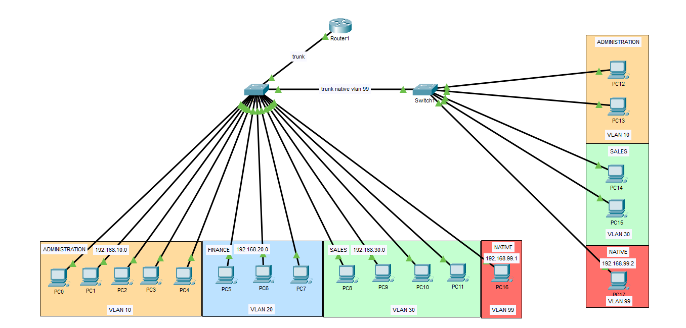

# VLAN Segmentation and Router-on-a-Stick

## Overview

In this lab I design and simulate a multi-switch network in Cisco Packet Tracer using VLANs, IEEE 802.1Q trunking, and router-on-a-stick inter-VLAN routing.

The network connects two switches. The first switch connects to a router and provides connectivity for Administration, Finance, and Sales. The second switch extends selected VLANs to additional workstations.

A dedicated VLAN 99 is used as the native VLAN for trunking tests, with a statically addressed workstation to verify untagged frame forwarding across the inter-switch trunk.

## Objectives

- Create and assign VLANs to departmental workstations.
- Configure 802.1Q trunk links between switches and between the switch and router.
- Configure VLAN 99 as the native VLAN on the relevant trunk links.
- Implement router-on-a-stick using router subinterfaces.
- Configure separate IP networks and DHCP pools for VLANs 10, 20, and 30.
- Verify VLAN membership, trunk operation, DHCP assignment, and inter-VLAN routing.
- Test native VLAN connectivity using a statically addressed workstation.

## Technologies

- Cisco Packet Tracer
- VLANs and Layer 2 switching
- IEEE 802.1Q trunking
- Native VLAN configuration
- Router-on-a-stick
- IPv4 addressing and subnetting
- DHCP
- Inter-VLAN routing
- Cisco IOS CLI

## Network Design

The network uses the following VLAN assignments:

- VLAN 10 — Administration
- VLAN 20 — Finance
- VLAN 30 — Sales
- VLAN 99 — Native VLAN and trunking test

The first Switch connects the departmental VLANs to a router through a trunk link. The router uses subinterfaces on its GigabitEthernet0/0 physical interface to provide a default gateway and DHCP service for each departmental VLAN.

A second switch connects to the primary switch through an 802.1Q trunk and extends VLANs 10 and 30, as well as VLAN 99 for native VLAN testing.

## Network Topology

## VLAN and IP Addressing Plan

See [VLAN and IP Addressing Plan](docs/vlan-and-ip-addressing-plan.md).

## Configuration and Implementation

The Packet Tracer simulation is provided in `02-VLAN-segmentation-and-inter-VLAN-routing.pkt`.

The implementation covers VLAN creation, access-port assignment, trunk configuration, router subinterfaces, DHCP pools, and native VLAN testing.

## Validation and Testing

See [Test Results](docs/test-results.md) for the VLAN, trunking, DHCP, routing, and connectivity verification results.

## Lessons Learned

- VLANs create separate Layer 2 broadcast domains, while inter-VLAN communication requires Layer 3 routing.
- 802.1Q trunks carry traffic for multiple VLANs over a single physical link using VLAN tags, except for traffic belonging to the configured native VLAN as those are tagless.
- Router subinterfaces allow one physical router interface to serve multiple IP networks.
- Native VLAN configuration must be consistent across the relevant trunk endpoints to avoid VLAN mismatches.
- Verification commands and end-to-end tests help identify configuration errors across switches and the router.
