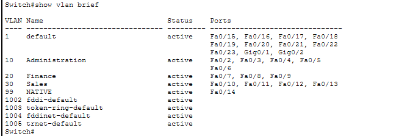
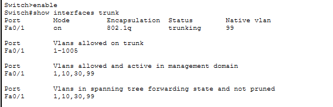
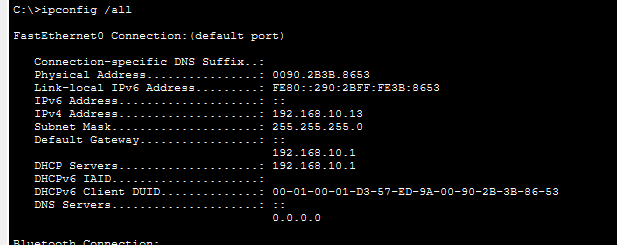
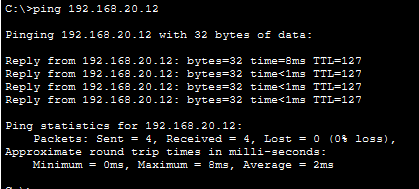
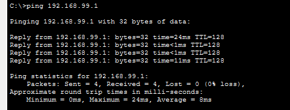

# Network Test Results

## 1. Test Environment

- Simulator: Cisco Packet Tracer
- Architecture: Router-on-a-stick with two interconnected switches
- VLANs: 10, 20, 30, and 99
- Routing: Inter-VLAN routing through router subinterfaces

## 2. Test Matrix

| ID | Test | Verification Method | Expected Result | Actual Result | Status |
|---|---|---|---|---|---|
| T01 | VLAN creation | `show vlan brief` | All required VLANs exist | [see result](../tests/vlan-brief.png) | TESTED |
| T02 | Access-port assignment | `show vlan brief` | Workstations belong to the correct VLANs | [see result](../tests/vlan-brief.png) | TESTED |
| T03 | Trunk operation | `show interfaces trunk` | Required VLANs are allowed and active | [see result](../tests/show-interfaces-trunk.png) | TESTED |
| T04 | Native VLAN configuration | `show interfaces trunk` | Native VLAN is 99 on the inter-switch trunk | [see result](../tests/show-interfaces-trunk.png) | TEST |
| T05 | DHCP assignment | `ipconfig /all` | Each departmental PC receives an address from its correct subnet | [see result](../tests/dhcp.png) | TESTED |
| T06 | Gateway reachability | `ping <gateway-ip>` | Workstation reaches its own gateway | [see result](../tests/show-interfaces-trunk.png) | TESTED |
| T07 | Inter-VLAN routing | Ping between departmental PCs | Communication succeeds when routing and policies permit | Pending | NOT TESTED |
| T08 | Native VLAN connectivity | Ping between VLAN 99 PCs | Static-IP PCs on different switches communicate | Pending | NOT TESTED |

## 3. Tests

### VLAN verification

### Trunk verification

### DHCP verification

### Inter-VLAN connectivity

### Native VLAN forwarding

## 4. Troubleshooting Log

- **Problem:** A mismatch in the vlans over the native trunk connection, switch 2 native trunk is configured for vlan 99, while switch 1 retained the default vlan 1 configuration
- **Diagnosis:** Interface has been blocked and a port inconsistency error displayed on the switch cli
- **Resolution:** Reconfiguring fa/24 interface to vlan 99

## 5. Summary

- Tests performed: [Fill in]
- Tests passed: [Fill in]
- Tests failed: [Fill in]
- Tests not performed: [Fill in]

Only mark a test as PASS after observing and verifying its actual result.
